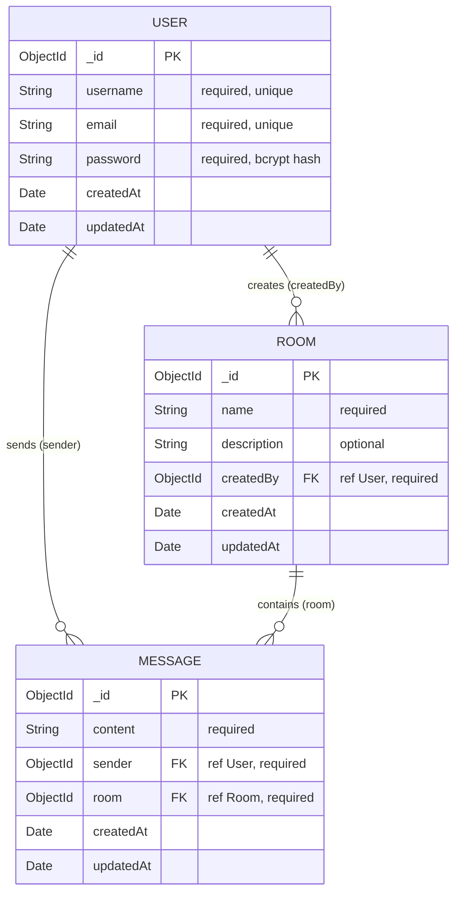

# Data schema

Database: `studyroom` (MongoDB). Every document also gets an `_id` (ObjectId). Because the schemas use `timestamps: true`, Mongoose also adds `createdAt` and `updatedAt` (Date) to each one.

## `users`

Model: [server/models/User.js](../server/models/User.js)

| Field       | Type     | Rules              | Notes                                         |
|-------------|----------|--------------------|-----------------------------------------------|
| `_id`       | ObjectId | auto               |                                               |
| `username`  | String   | required, unique   | Shown in rooms and messages                   |
| `email`     | String   | required, unique   | Used to log in                                |
| `password`  | String   | required           | bcrypt hash. The API never returns it         |
| `createdAt` | Date     | auto               |                                               |
| `updatedAt` | Date     | auto               |                                               |

## `rooms`

Model: [server/models/Room.js](../server/models/Room.js)

| Field         | Type     | Rules                | Notes                          |
|---------------|----------|----------------------|--------------------------------|
| `_id`         | ObjectId | auto                 |                                |
| `name`        | String   | required             |                                |
| `description` | String   | optional             |                                |
| `createdBy`   | ObjectId | required, **→ User** | The user who created the room  |
| `createdAt`   | Date     | auto                 |                                |
| `updatedAt`   | Date     | auto                 |                                |

## `messages`

Model: [server/models/Message.js](../server/models/Message.js)

| Field       | Type     | Rules                | Notes                          |
|-------------|----------|----------------------|--------------------------------|
| `_id`       | ObjectId | auto                 |                                |
| `content`   | String   | required             | Message text                   |
| `sender`    | ObjectId | required, **→ User** | Who sent it                    |
| `room`      | ObjectId | required, **→ Room** | Which room it belongs to       |
| `createdAt` | Date     | auto                 | Used to sort messages by time  |
| `updatedAt` | Date     | auto                 |                                |

## References

| From               | To      | Meaning                                    |
|--------------------|---------|--------------------------------------------|
| `Room.createdBy`   | `User`  | One user creates many rooms                |
| `Message.sender`   | `User`  | One user sends many messages               |
| `Message.room`     | `Room`  | One room holds many messages               |

## Which screen uses which data

| Screen            | Reads                                             | Writes            |
|-------------------|---------------------------------------------------|-------------------|
| Login / Register  | `users`                                           | `users`           |
| Rooms list        | `rooms` (+ `createdBy.username`)                  |                   |
| Create room       |                                                   | `rooms`           |
| Room chat         | `rooms`, `messages` (+ `sender.username`)         | `messages`        |
