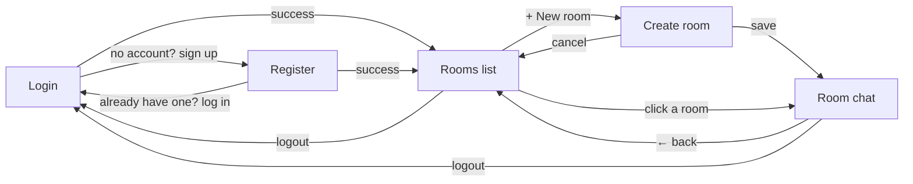

# Wireframes

Low-fi sketches of each main screen, plus a diagram of how users move between them.

## Screen flow



On page load the client checks for a saved token. With a valid token it goes straight to **Rooms list**; otherwise it shows **Login**.

## 1. Login

```
+------------------------------------------+
|                StudyRoom                 |
|                                          |
|   Email     [__________________________] |
|   Password  [__________________________] |
|                                          |
|            [        Log in        ]      |
|                                          |
|   No account? Sign up                    |
|   (error message shows here)             |
+------------------------------------------+
```

## 2. Register

```
+------------------------------------------+
|           Create your account            |
|                                          |
|   Username  [__________________________] |
|   Email     [__________________________] |
|   Password  [__________________________] |
|                                          |
|            [       Sign up        ]      |
|                                          |
|   Already have an account? Log in        |
|   (e.g. "Username already taken")        |
+------------------------------------------+
```

## 3. Rooms list (home)

```
+------------------------------------------------+
| StudyRoom            Welcome, alice  [Logout]  |
+------------------------------------------------+
|  Study rooms                     [+ New room]  |
|                                                |
|  +------------------------------------------+  |
|  | Calculus II                              |  |
|  | Exam prep for Friday       by bob        |  |
|  +------------------------------------------+  |
|  | Web Dev Capstone                         |  |
|  | Milestone help              by alice     |  |
|  +------------------------------------------+  |
|                                                |
|  (empty state: "No rooms yet, create one")     |
+------------------------------------------------+
```

## 4. Create room

```
+------------------------------------------------+
| StudyRoom            Welcome, alice  [Logout]  |
+------------------------------------------------+
|  New study room                                |
|                                                |
|  Name         [______________________________] |
|  Description  [______________________________] |
|               [______________________________] |
|                                                |
|               [ Cancel ]   [ Create room ]     |
+------------------------------------------------+
```

## 5. Room chat

```
+------------------------------------------------+
| ← Rooms      Calculus II     alice  [Logout]   |
|              Exam prep for Friday              |
+------------------------------------------------+
|  bob  10:02                                    |
|  Anyone done problem 4?                        |
|                                                |
|                            alice  10:03        |
|                   Yes, use integration by parts|
|                                                |
|  carol  10:05                                  |
|  Thanks!                                       |
|                                                |
+------------------------------------------------+
|  [ Type a message...                ] [Send]   |
+------------------------------------------------+
```

Messages are sorted by `createdAt`. Your own messages sit on the right. Real-time updates via Socket.IO are planned for a later milestone.
